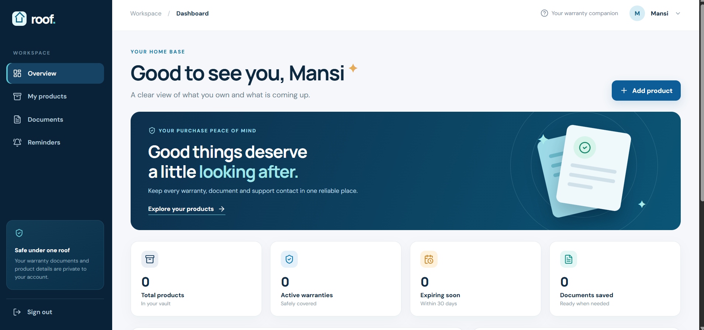

# Roof

**Your warranties and product documents, together under one roof.**

Roof is a full-stack warranty and document vault. It gives each user a private place to track products, see when coverage ends, and keep receipts, invoices, warranty cards, manuals, and service records ready when they are needed. A dashboard highlights upcoming expiries, while configurable email reminders help users act before coverage runs out.

Built as a college project with **React, Node.js, Express, and MongoDB**.

## Dashboard



_Dashboard view before products and documents are added._

## Features

| Area              | What Roof does                                                                                                                                              |
| ----------------- | ----------------------------------------------------------------------------------------------------------------------------------------------------------- |
| Accounts          | Register, sign in, sign out, change your password, and delete your account with all its data. Each user's records are isolated from other accounts.         |
| Products          | Add, search, filter, edit, and delete products with purchase details, warranty terms, and notes.                                                            |
| Warranty tracking | Calculate an end date from a start date and duration, or enter the manufacturer's stated end date. Show active, expiring, expired, and incomplete coverage. |
| Document vault    | Upload and privately preview or download PDF, PNG, and JPEG proof. Search across products and filter by document type.                                      |
| Dashboard         | See product and document totals, coverage status, and upcoming warranty expiries.                                                                           |
| Reminders         | Choose email reminder offsets, inspect delivery history, and let a background worker send due messages.                                                     |
| Service contacts  | Save a product's service center name, phone number, address, and website.                                                                                   |

### Typical workflow

1. Create an account and add a product with its purchase and warranty details.
2. Upload its receipt, invoice, warranty card, or other useful documents.
3. Find the product or its files later through search and the document vault.
4. Check coverage on the dashboard and receive reminders in the local inbox or through a configured email provider.
5. Open the saved proof and service contact when a repair or warranty claim is needed.

## Technology and architecture

| Layer             | Technology                                                    | Responsibility                                                            |
| ----------------- | ------------------------------------------------------------- | ------------------------------------------------------------------------- |
| Web app           | React 19, React Router, Vite, JavaScript, CSS, Lucide, PDF.js | Responsive interface, forms, dashboard, and PDF/image previews            |
| API               | Node.js, Express 5, Zod                                       | Authentication, validation, owner checks, and application endpoints       |
| Database          | MongoDB, Mongoose                                             | Users, sessions, products, document metadata, contacts, and reminder jobs |
| File storage      | MongoDB GridFS                                                | Private PDF and image content                                             |
| Email worker      | Node.js, Nodemailer                                           | Scheduled reminder processing and SMTP delivery                           |
| Local development | mongodb-memory-server, smtp-server                            | Persistent local database and local inbox without external accounts       |

```text
Browser (React)
    │  /api requests and session cookie
    ▼
Express API ───────────────► MongoDB collections
    └── document uploads ───────► MongoDB GridFS

Reminder worker ───────────► MongoDB reminder jobs
    └── due email ──────────────► SMTP server
```

The Vite development server proxies `/api` to Express. In production, Express can serve the built React app and API from the same origin.

## Quick start

**Requirements:** Node.js 22.12 or newer, npm, Git (or a downloaded repository ZIP), and internet access for `npm ci` and the first local MongoDB binary download. The default local setup uses ports **5173**, **4000**, **8025**, and **1025**. You do not need MongoDB Atlas, a separately installed MongoDB server, or SMTP credentials.

Clone the repository and run these commands from its root on Windows, macOS, or Linux:

```bash
git clone https://github.com/mansiverma897993/Roof.git
cd Roof
npm ci
npm run local
```

If you downloaded the ZIP instead, extract it, open a terminal in the extracted `Roof` folder, and run `npm ci` followed by `npm run local`.

Open **[http://localhost:5173](http://localhost:5173)**, then register an account. Keep the terminal open while using Roof; press `Ctrl+C` to stop it. Restart later with `npm run local` from the repository root.

| Local URL                                                            | What it shows                              |
| -------------------------------------------------------------------- | ------------------------------------------ |
| [http://localhost:5173](http://localhost:5173)                       | Roof web app                               |
| [http://localhost:4000/api/health](http://localhost:4000/api/health) | API health response (`{"status":"ok"}`)    |
| [http://localhost:8025](http://localhost:8025)                       | Captured reminder emails for local testing |

`npm run local` starts the frontend, API, reminder processor, a local MongoDB instance, and a loopback-only local email inbox. Database data is stored in the ignored `.local-mongo/` directory; captured emails are in `.local-mail/`. Both survive restarts. Reminder emails appear in the local inbox without requiring an external SMTP account; they are not delivered to real email addresses. The worker schedules due messages for **9:00 AM in the account's time zone** on the selected reminder day.

To try the full workflow: add a product with a warranty date, upload a receipt or warranty card, view coverage on the dashboard, find the document in the vault, and choose reminder timing on the Reminders page. Due messages appear in the local inbox.

For a temporary database that is removed when the process stops, run `npm run demo` instead. Demo mode does not provide the local inbox unless you configure an SMTP provider.

### Use your own MongoDB

Use this mode when you already have a MongoDB server or Atlas cluster. Create `server/.env` from the checked-in template and set `MONGODB_URI`:

```powershell
Copy-Item server/.env.example server/.env
```

On macOS or Linux, use `cp server/.env.example server/.env`. A separately running local MongoDB can use `mongodb://127.0.0.1:27017/roof`; for Atlas, use your own connection URI and grant the database user read/write access. Keep the URI private.

Then run:

```bash
npm run dev
```

`npm run dev` starts the Express API, a separate reminder worker, and Vite. It expects MongoDB to be available at the configured URI. The `.env` file is ignored by Git. `npm run local` creates its own database and does not need `MONGODB_URI`.

## Configuration

All server settings belong in `server/.env`. See [`server/.env.example`](server/.env.example) for the complete template.

| Variable                 | Purpose                                                    | Development default              |
| ------------------------ | ---------------------------------------------------------- | -------------------------------- |
| `NODE_ENV`               | Set to `production` for deployment                         | `development`                    |
| `PORT`                   | Express port                                               | `4000`                           |
| `MONGODB_URI`            | MongoDB connection string for `npm run dev` and production | `mongodb://127.0.0.1:27017/roof` |
| `APP_ORIGIN`             | Exact allowed browser origin                               | `http://localhost:5173`          |
| `SMTP_HOST`              | SMTP server; required for real email delivery              | Unset                            |
| `SMTP_PORT`              | SMTP port                                                  | `587`                            |
| `SMTP_SECURE`            | `true` for implicit TLS, otherwise `false`                 | `false`                          |
| `SMTP_USER`, `SMTP_PASS` | SMTP authentication when your provider requires it         | Unset                            |
| `SMTP_FROM`              | Sender address shown on reminder emails                    | `Roof <no-reply@example.com>`    |
| `WORKER_INTERVAL_MS`     | Time between reminder checks                               | `60000`                          |
| `TRUST_PROXY`            | Number of reverse proxies in front of Express              | `0` (`1` in production)          |

Per-account limits (products, documents, storage, contacts, request rates, sign-in lockout) live in `config.limits` in [`server/src/config.js`](server/src/config.js).

The local and demo commands provide their own MongoDB instances; they still read other settings from `server/.env`. `npm run local` automatically captures reminder emails at `http://localhost:8025` when `SMTP_HOST` is unset. If `SMTP_HOST` is set, it sends using that provider instead. **Real inbox delivery requires working SMTP credentials.** With `npm run dev` or `npm run demo`, leaving `SMTP_HOST` unset causes due attempts to be retried or marked failed rather than sent.

### Send reminders to real inboxes

Obtain SMTP settings from an email provider and put them in the ignored `server/.env` file. For example:

```dotenv
SMTP_HOST=your-smtp-host
SMTP_PORT=587
SMTP_SECURE=false
SMTP_USER=your-smtp-username
SMTP_PASS=your-smtp-password-or-app-password
SMTP_FROM=Roof <your-authorized-sender@example.com>
```

The sender must be permitted by your provider. Port 465 normally uses `SMTP_SECURE=true`; port 587 normally uses `SMTP_SECURE=false` with STARTTLS. Restart Roof after changing `.env`, then test a due reminder with a mailbox you control. Never commit or share your credentials. See the [operations guide](docs/OPERATIONS.md#email-delivery) for a Gmail example and backup procedures.

## Project commands

| Command                    | Purpose                                                                       |
| -------------------------- | ----------------------------------------------------------------------------- |
| `npm run local`            | Start the full app with persistent local MongoDB data and a local email inbox |
| `npm run demo`             | Start the full app with disposable MongoDB data                               |
| `npm run dev`              | Start the API, worker, and frontend using `MONGODB_URI`                       |
| `npm test`                 | Run server and client tests                                                   |
| `npm run build`            | Build the React app into `client/dist/`                                       |
| `npm run start`            | Start the API with an existing MongoDB connection                             |
| `npm run worker -w server` | Start the reminder worker separately                                          |

## API overview

All routes below are under `/api`. Private routes require a valid session cookie; requests are scoped to the signed-in user.

| Area             | Routes                                                                                                                |
| ---------------- | --------------------------------------------------------------------------------------------------------------------- |
| Authentication   | `POST /auth/register`, `POST /auth/login`, `POST /auth/logout`, `GET/DELETE /auth/me`, `POST /auth/password`          |
| Products         | `GET/POST /products`, `GET/PATCH/DELETE /products/:id`                                                                |
| Documents        | `GET /documents`, `GET/POST /products/:productId/documents`, `PATCH/DELETE /documents/:id`, `GET /documents/:id/file` |
| Dashboard        | `GET /dashboard/summary`                                                                                              |
| Reminders        | `GET/PUT /reminder-preferences`, `GET /reminders/history`                                                             |
| Service contacts | `GET/POST /products/:productId/service-centers`, `PATCH/DELETE /service-centers/:id`                                  |

The older `/receipts` routes have been removed; use the `/documents` routes, which cover receipts as a document type.

## Data rules and privacy

- Passwords are hashed with bcrypt and must be 10 characters to 72 bytes. Sessions use random tokens stored as hashes in MongoDB and sent in `HttpOnly`, `SameSite=Strict` cookies. Changing your password signs out every other device.
- Sign-in is rate limited per IP, and an account pauses sign-in for 15 minutes after 5 wrong passwords. Failed sign-ins always return the same message and take the same time, whether or not the account exists.
- Every private route checks the account owner. Document files are streamed through authenticated endpoints; GridFS is not publicly exposed. API responses leave out internal owner and storage IDs.
- Uploads are limited to **10 MB per file**, streamed straight into GridFS, and accepted only when their file signatures match PDF, PNG, or JPEG. Ownership and account quotas are checked before any bytes are read.
- Each account can hold up to 500 products, 1,000 documents, 500 MB of files, and 20 service contacts per product.
- Deleting your account permanently removes its products, documents, files, contacts, reminders, and sessions.
- A calculated warranty ends on the day before the start date's anniversary after the entered number of calendar months. A supplied manufacturer end date takes precedence. Coverage stays active through its end date; the final 30 days appear as **expiring**.
- Reminder times use the user's time zone. The worker tracks pending, sent, retried, failed, and cancelled jobs. SMTP acceptance followed by a worker crash can still result in a retry, so external email delivery is not guaranteed to be exactly once.
- `.env`, `.local-mongo/`, `.local-mail/`, build output, and dependencies are excluded from Git.

## Security hardening

A security review found no injection, authentication bypass, or cross-account access. It did find the issues below, which are now fixed. Each fix is covered by [`server/test/security.test.js`](server/test/security.test.js).

| Risk   | Issue                                                                                                                      | Fix                                                                                                                                                                      |
| ------ | -------------------------------------------------------------------------------------------------------------------------- | ------------------------------------------------------------------------------------------------------------------------------------------------------------------------ |
| High   | Uploads were buffered fully in memory before ownership was checked, so parallel 10 MB uploads could exhaust server memory. | A custom multer storage engine streams uploads into GridFS while checking the file signature. Ownership and quotas are checked first; uploads are rate limited per user. |
| High   | Dependency advisories in `multer` and `body-parser` (denial of service).                                                   | Updated to patched versions; CI fails on new high-severity advisories.                                                                                                   |
| Medium | Sign-in limits were per IP only, so attackers spread across many IPs could keep guessing one account's password.           | Per-account lockout stored in MongoDB, so it works across processes and IPs.                                                                                             |
| Medium | Unknown emails were answered faster than wrong passwords, revealing which accounts exist.                                  | Login always runs a bcrypt comparison and returns one message for every failure.                                                                                         |
| Medium | No per-account limits on products, documents, storage, or contacts.                                                        | Quotas in `config.limits`, plus a general API rate limit.                                                                                                                |
| Low    | The origin check allowed writes with no `Origin` header.                                                                   | Writes are also refused when the browser's `Sec-Fetch-Site` header shows a cross-site request.                                                                           |
| Low    | Responses included `userId`, `__v`, and GridFS file IDs.                                                                   | Records are stripped of internal fields before they are sent.                                                                                                            |
| Low    | 8-character minimum, and passwords over 72 bytes were silently truncated by bcrypt.                                        | New passwords need 10 characters and at most 72 bytes. Existing accounts can still sign in with their current password.                                                  |
| Low    | `trust proxy` was fixed at 1, so extra proxy hops would let clients spoof their IP for rate limits.                        | Configurable with `TRUST_PROXY`.                                                                                                                                         |
| Low    | Unused legacy `/receipts` routes widened the API.                                                                          | Removed.                                                                                                                                                                 |
| Bug    | Non-Latin file names (for example Hindi) were stored garbled, and downloading them could fail.                             | Names are read as UTF-8 and sent with an RFC 5987 `filename*` header.                                                                                                    |
| Gap    | No way to change a password or delete an account and its data.                                                             | Added to the new **Account** page.                                                                                                                                       |

The document vault search now runs in MongoDB instead of loading every document into memory.

**Known limitations**

- Registering with an email that is already in use says so. Hiding this needs email verification, which Roof does not have yet. The sign-in rate limit slows anyone checking many emails.
- Rate-limit counters are kept in memory per API process. If you run more than one API process, use a shared store such as Redis. The per-account lockout is stored in MongoDB and is not affected.
- A lockout can be triggered on purpose by someone who knows an email address. It lasts 15 minutes.

## Testing

```bash
npm test
npm run build
```

The server tests cover date rules, account isolation, product and document operations, contacts, dashboard results, validation, reminder processing, and the security protections above. The client test covers warranty date preview. Tests use temporary MongoDB and a local SMTP server; they do not require real inbox credentials. GitHub Actions runs the dependency audit, tests, and build on every push to `main` and every pull request.

### Troubleshooting

| Problem                               | Check                                                                                                                          |
| ------------------------------------- | ------------------------------------------------------------------------------------------------------------------------------ |
| Frontend opens but data does not load | Check [API health](http://localhost:4000/api/health), the terminal output, and whether port 4000 is free.                      |
| First local start takes time          | Allow the MongoDB binary download to finish; check the terminal for download or connection errors.                             |
| Local inbox is empty                  | A reminder must be due before the worker sends it. Check its schedule and status on the Reminders page.                        |
| Real email does not arrive            | Confirm the SMTP host, port, security mode, credentials, and authorized sender; inspect reminder history for a delivery error. |
| Local data seems missing              | Use `npm run local` with the original `.local-mongo/` directory. `npm run demo` deliberately uses disposable data.             |

## Repository layout

```text
client/                 React application, styles, and client tests
server/src/routes/      Express API routes
server/src/lib/         Authentication, dates, and reminder logic
server/src/models.js    Mongoose schemas
server/src/worker.js    Email reminder worker
server/src/local.js     Persistent local app runner
server/test/            API, security, and date tests
server/.env.example     Server configuration template
.github/workflows/      Continuous integration
docs/                  Operations and project documentation
Warranty_Receipt_Vault_Architecture.pdf   Initial architecture document
```

## Deployment notes

Build the frontend with `npm run build`, configure a persistent MongoDB and real SMTP provider, and run the API (`npm run start`) and worker (`npm run worker -w server`) as supervised processes. Express serves `client/dist/` alongside `/api`. Set `NODE_ENV=production` and `APP_ORIGIN` to the site's exact HTTPS origin, and set `TRUST_PROXY` to the number of proxies in front of Express. Serve the app behind HTTPS so production session cookies work, and back up both MongoDB collections and GridFS files. Follow the [backup and recovery guide](docs/OPERATIONS.md). Keep `server/.env`, `.local-mongo/`, and `node_modules/` out of Git.

The [architecture PDF](Warranty_Receipt_Vault_Architecture.pdf) documents the initial requirements and design. The searchable document vault is an extension of that initial scope.
